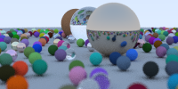

# RayTracing123

This is a study note and implementation of the [Ray Tracing series](https://raytracing.github.io/) by Peter Shirley.

## Progress

- [x] Book 1: Ray Tracing in One Weekend
- [ ] Book 2: Ray Tracing: The Next Week
- [ ] Book 3: Ray Tracing: The Rest of Your Life

## Render Result

## Documentation

- Detailed study notes: [Note.md](./RayTracing123/Note.md)

## How to Build

1. Clone this repository.
2. Open `RayTracing123.slnx` in Visual Studio.
3. Build and run. The generated image will be saved in the output directory.

*This project will be updated continuously as I progress through the books.*
