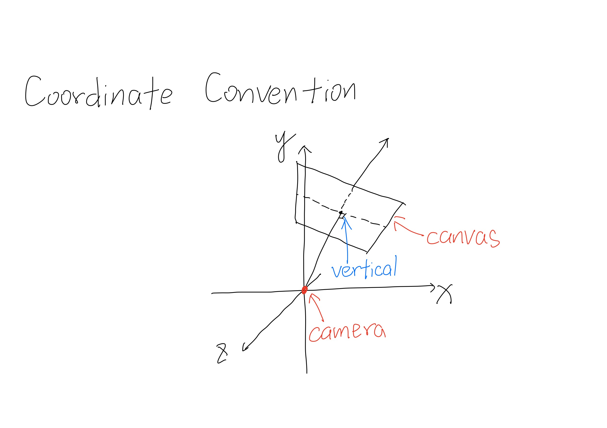
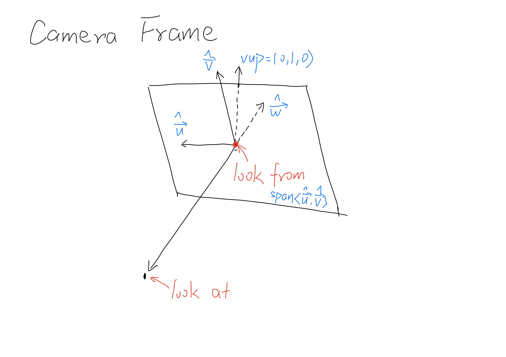
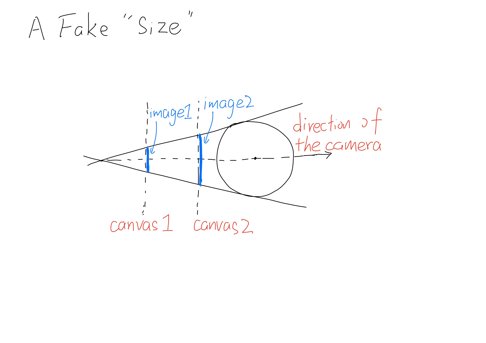
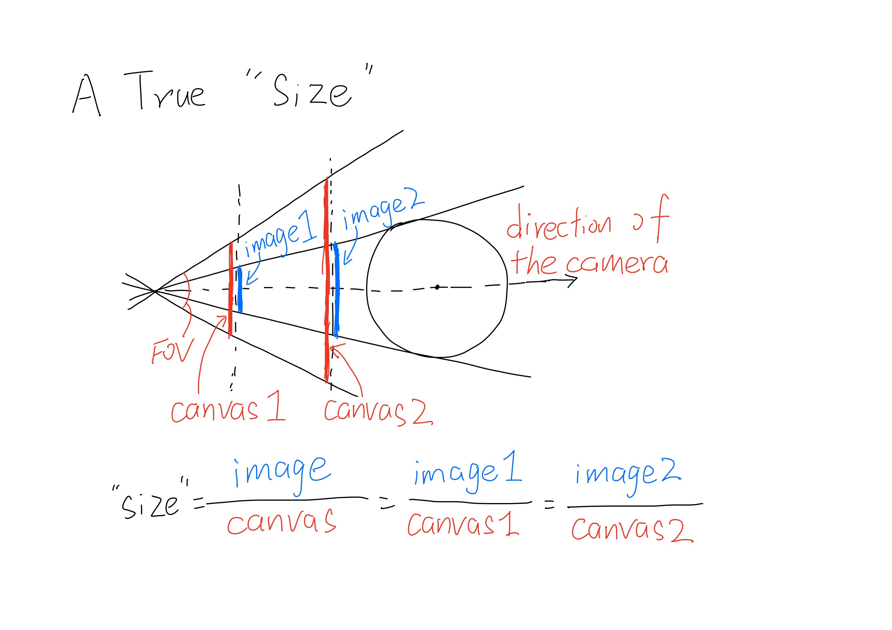
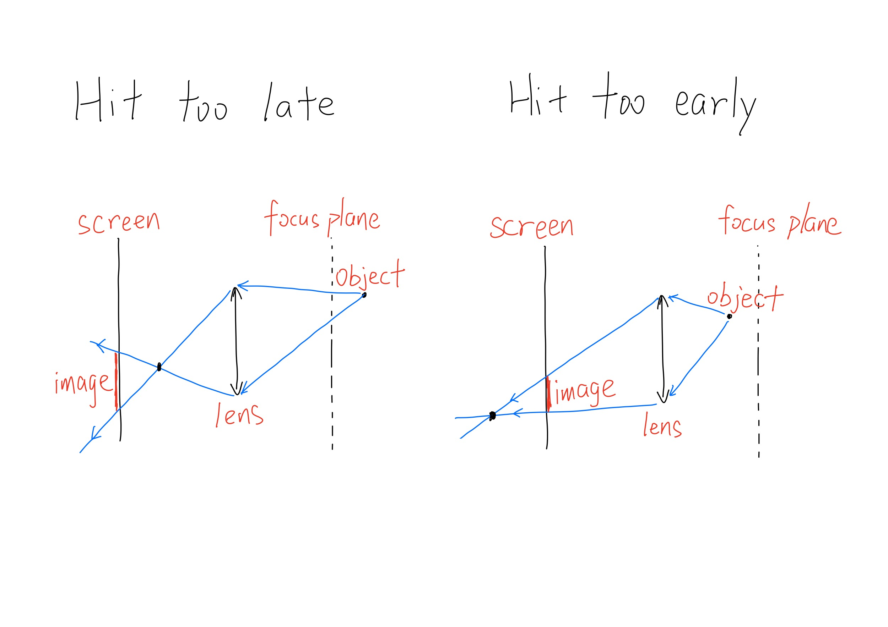
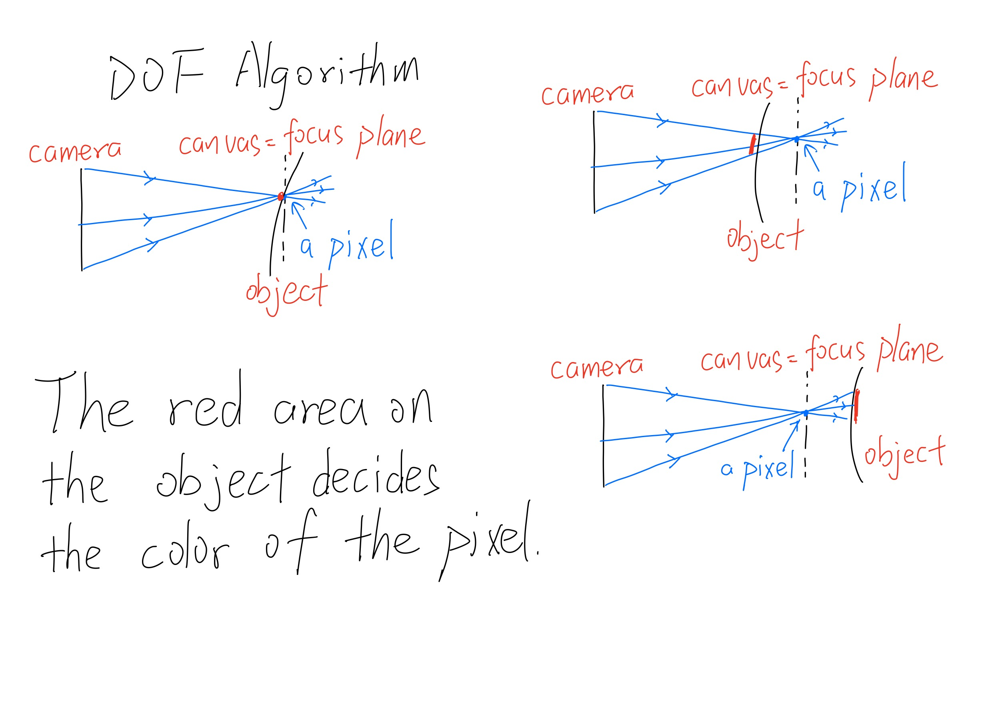
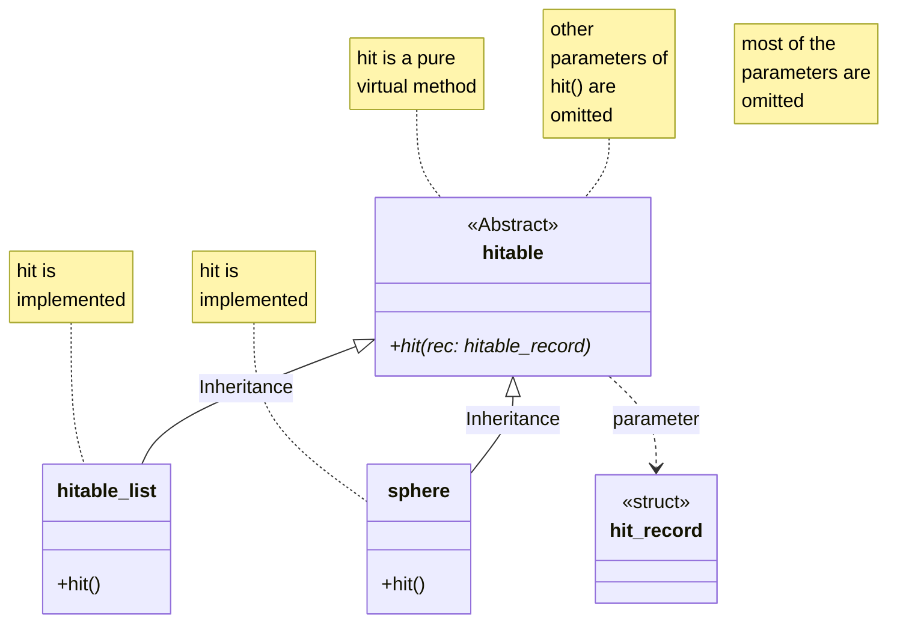
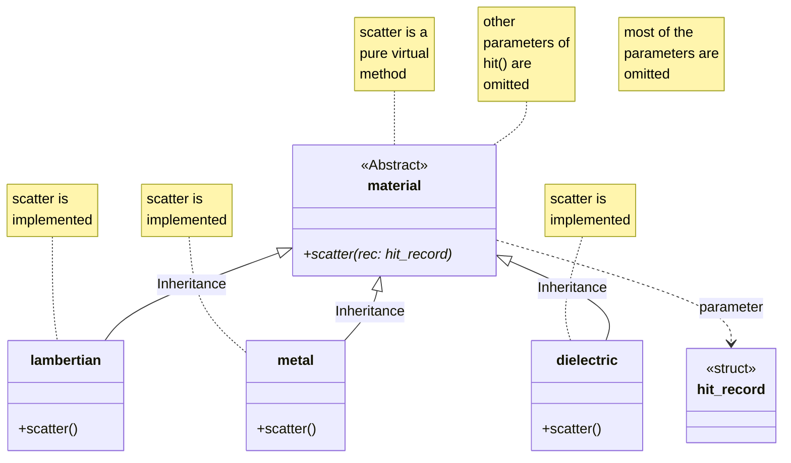
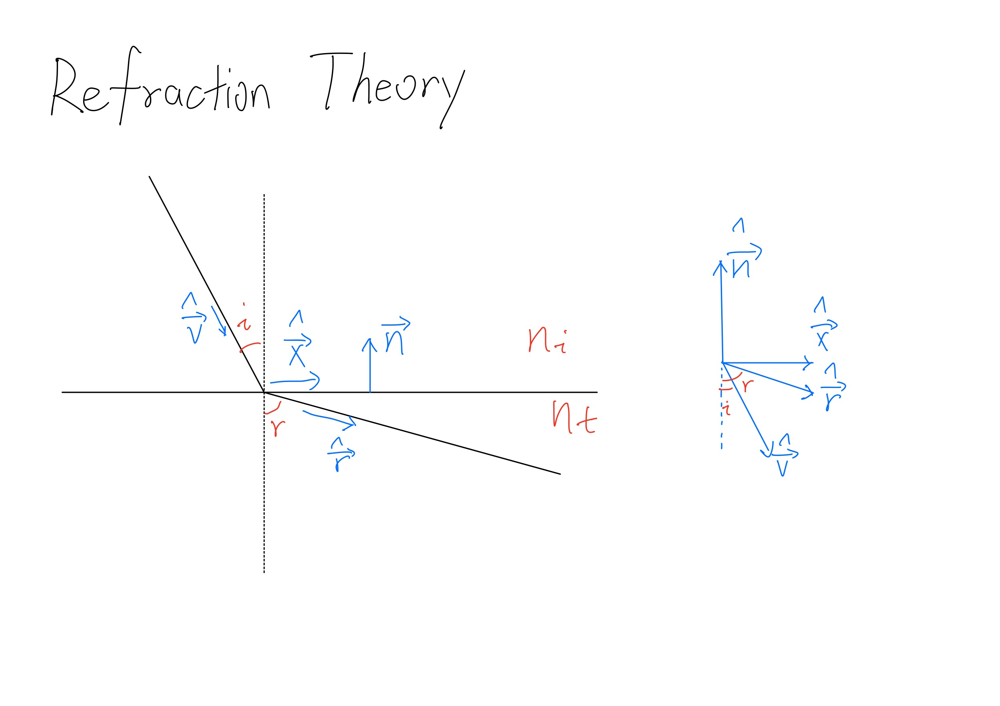
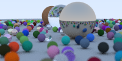

# Notes On Ray Tracing Trilogy (Peter Shirley)

This is my study notes on ray tracing series by Peter Shirley. However, perspectives and knowledge in this note will not merely come from the trilogy, so this could also be regarded as a note on ray-tracing technology itself.

## Basic ideas of ray tracing

### Diversed ray tracing (DRT)

Ray tracing literally means "draw a picture" by tracing each rays we care about. Therefore, according to different ways we trace the rays, we have diversed strategies. The strategy I will discuss here is called the "diversed ray tracing" and here's what this means: instead of **RECEIVING** light from the scene as how the real world works, we "**EMIT**" light, calculate its features, and pass them to the canvas. As we can see from the definition, the propagation way of the ray is **DIVERSED** comparing to real world; this is way it's *diversed*.

### Process of DRT

In DRT, we have a *camera*, pointing at the *scene*. Ray is emit by the camera, go through the *canvas*, and interact with objects in the scene. Obviously, each ray will go through a pixel on the canvas, so what we need to do is decide the color corresponding to each ray and assign it to the pixel on the canvas.

## Ray tracing in a weekend

Coordinate convention:


### Camera and Canvas

The ```camera``` class actually determines both the camera and the canvas.

#### Camera

To describe a camera, we first need the position and the direction it is pointing at. The position is quite straightforward by setting a point called "look from"; to describe the direction, we simply assign the camera a point to "look at", then we can construct a vector stands for the direction. Conventionally, we choose the camera at the origin.

The camera is now able to placed at anywhere in the space and point to any direction. We can thus construct the canvas. One thing need to be mentioned before describing the canvas is that, **the canvas we construct is an Euclidean plane (a rectangle, more precisely), and the plane is vertical to the direction the camera is looking at**.

``get_ray`` function turn a point in the **scene** into a ray.

#### Canvas

Then let's describe the canvas.

First is to determin the plane. Note that the camera have a direction -- the direction pointing "up" from the head of the camera. Theoretically, then, using this direction and the looking-at direction, we can build a Descart frame using corss product. However, we use a trick here: **we make the up-direction (0, 1, 0)**. The reason we can do this is that the component parallel to the looking-at direction is eliminated when doing the cross product, so we are actually doing the same thing but in a more convenient way. Now the frame could be built up simply:


Then is the size. In this model, the feature is parameterized by the **FOV** and the **aspect**.

The last thing to do is to cut a rectangle on the plane we have just found. Using the frame fixed on the camera and the size of the canvas, the procedure is apparent.

#### Discuss: The FOV , canvas size and image size

There's one thing I want to discuss furthur before introducing the depth of field: what affect the size of the object in the picture? Conclusion first: in our model, the "size" is determined by FOV (and the aspect) and has nothing to do with the canvas-camera distance (so we did not describe such quantity), and this is an appropriate model. This may seems wierd -- consider this: we need to look at a sphere. The camera is a point, so we could construct a conical surface tangent to the sphere. Then, moving the canvas, we could find that the area of the intersection changes! But in the code, we do not have the distance at all, suggesting that the size of the sphere's image is supposed to remain constant. How's this happening?


The inconsistance occurs because I confounded "the size on the canvas" and "the area of the intersection". In fact, when we look at a picture, **what determines the "size" of an object is the ratio of the scale of the object's image to the scale of the canvas, instead of just the scale of the image**; the latter one is exactly the area of the intersection in the former example.

So now let's go back to the code. In the code, we set FOV a constant, which means that, when we move the position of the canvas, the size of the canvas changes while the area of the intersection (image of the sphere on the canvas) changes according to a same scale factor. So, (scale of the image)/(size of the canvas) is invariant, namely, the "size of object in the picture" doesn't change.


Here, another question occures. The quantities tangled together here are: FOV, camera-canvas distance and size of the canvas. In our model, we choose to fix the FOV, leaving the other two free to change. So instead of fixing FOV, can we fix the distance or the size of the canvas? I don't think that's a good choice, and here's my interpretation. The reason we don't care about the size and the distance in this model is that, the ratial size/distance is also fixed mathematically, so the size of the object in the picture is invariant -- choosing a single parameter, and we can have a certain result. But, fixing the size OR distance along could not have such a convenient result.

#### The DOF and the focus distance

Understanding the relationship between the FOV and the image size, we can now discuss the depth of field (DOP) and the focus-distance without ambiguity.

DOP is introduced to describe the "focus" of the camera.

To understand DOP, lets take a look at the real camera. We simplify the optics system to a single thin lens, and assume that all the planes we discuss are verticle to the light axis of the lens.

A point in the object space "emit" a set of light rays -- a light cone. The rays go through the lens, get converged to another light cone, and finally meet at a single point in the image space. When we taking photos at a fixed place and assign a specific recieving screen (the image distance), there's one and only one corresponding object-side plane (the object distance, called the *focus distance*) satisfying that for the point on this plane, the light cone converges exactly at a point on the recieving screen. Therefore, if the object point is not at the focus distance, the converged point at the image side will be at the front or the back of the recieving screen. The outcome is, whether the rays continue to propagate and hit the screen, or the rays hit the screen before meeting each other:

Both the situations give the output that **the image of a POINT in the object space is a REGION** -- the blur, and succesively the DOP, happen.

**Obviously, the greater the aperture is, the more blur the objects apart from the focus plane are.** This also coincide with our point-like camera; the camera has no aperture, so the "light cone" is simple a single light ray, thus no blur will generate.

Now the mechanism of the DOP is quite clear, understanding the implementation is not difficult then.

In our code, we use the canvas as the focus plane; this means that we fix the canvas. Why is this safe? Because the position of the canvas don't affect the size of the image as long as we adjust the size of the canvas correspondingly, which we have discussed before. This progress is in the constructor of the ``camera`` class.

The algorithm coloring the pixels is straightforward: if there are multiple rays from different point on the camera pointing to a single pixel on the canvas, then for this pixel, it's color is determined whether by a single object point (if there's an object point excactly on the canvas = focus plane) or by a set of object points (if there's no object points on the canvas = focus plane) therefore the pixel is blured. The mechanism is shown in the picture:

We used the ``random_in_unit_disk`` to generate a random point on the camera, and call the function in ``get_ray`` to turn it into a ray pointing at $(r, s)$ in the canvas coordinate. But ``get_ray`` only give us one ray, how do we generate multiple ones? Actually, this procedure is integrated in the *Monte Carlo* (MC) loop in the main program, to which we will turn later.

#### Summary for camera and canvas

In the ``camera`` class, we implemented a *camera* with arbitrary pointing angle and the *DOF*. We also implemented the *canvas*, parameterized by the *FOV*. The diveces to capture the scene are ready. The next step is to describe the scene properly.

### Hitable

In our code, the "object" in the scene is called "*hitable*". The implementation of the hitable have used several classes; the UML diagram is shown below:



As we can see, the only thing that ``hitable`` does is ``hit()``. The full signature of ``hit()`` is

```C++
virtual bool hit(
    const ray& r,
    double tmin,
    double tmax,
    hit_record& rec
) const;
```

So the task of ``hit()`` is clear: decide whether ``r`` hit something within parameter ``tmin`` and ``tmax``, and bring a hit record out side the method for other use.

Successively, what the classes representing true hitables, like ``sphere``, do is also clear, which is implementing the logic judging if the ray hits the hitable. These classes need to implement some detailed features such as material, position and size, of course.

In a real scene, a more common situation is that there are multiple hitables on a route of a ray. To deal with it, we introduced the class ``hitable_list`` standing literally for "a list of hitables". The ``hit`` method of ``hitable_list`` then only collect the nearest record.

Another characteristic of the hitable "family" is that ``hitable`` is an abstract class. This is polymorphism -- hitable acts as an interface, helping the caller get rid of the details.

This feature decides the implementation of ``hitable_list``: the ``list`` member is a double pointer. The first layer implies an implicit conversion from a ``list`` object to a derived-class object and the second layer impies an array of hitable. By doing this, we can manage different species of hitable unifiedly.

Now the only equivocal part of the family is the members of ``hit_record``. Here they are:

```C++
struct hit_record
{
    double t;       // parameter in the line equation
    vec3 p;         // point coresponding to t
    vec3 normal;    // nomal vector at point p
    material* mat_ptr;
};
```

### Material and color

The next step is to calculate how the rays interact with hitables and how to assign color to pixels.

Instead of explaining them in the order they happens, I want to discuss the color first because the ways that the ray-hitable interaction is nothing but mathematical and physical details -- they share the same interface after all!

#### ``color`` function

The ``color`` function is in the main programm, assigning a RGB code for a pixel. It is implemented as a recursion but the logic is actually unambiguous once you unerstand what physical world happens.

Imagine a ray travelling in a scene. There are two possibilities: the ray goes straight to the background, or the ray hits something and goes elsewhere. In the former situation, we simply assign the color of the background to the pixel that the ray went through; in the latter one, again, ther are two possibilities: the ray goes straight to the background, ot the ray hits something else and goes another elsewhere... Now you can see the recursion right? There are two ends: one is that the ray is finnaly scattered into the background, carrying the color of background with the information of the materials -- *attenuation*, as will be mentioned soon. The other is that the ray is scattered in the scene for so many times that it is hard to see, so we "kill" it artifitially, by introducing the ``depth``, to save the running time of the program.

There are two more things need mention.

First, not all portion of the ray are scattered. We solve this problem by introducing ``attenuation``. Why red looks "red" under sunlight? Because when sunshine occurs a red object, some opponents are absorbed and the rest are scattered. We simply interpret these opponents together "red" so we call the object "red". This is why the attenuation is implemented as a vector instead of a number -- to describe that hitable could have different abilities absorbing different opponents (R, G and B).

Second, there are actually multiple scattered ray**s**. This is not difficult to understand: if the scattered light goes only to one direction, then you will not be able to see the object from other ways. This is true even for mirror-reflecting objects like mirror and metal. How do we deal with this? Apparently, this is vital for our tracer, but if we trace each and every of the scattered rays, the amount of calculation would increase exponentially, which is absurd. We solve the dillema by the MC loop, which is once mentioned in the DOP section if you have a good memory. Still, I will postpone detailed discussion on this to the latter section and go to the next topic of discussion: material. For now, you only need to know that we choose one scattered ray randomly according to some rules. So if there are multiple rays shooting at a single point, then we will have a set of scattered rays, distrubuting as we want.

#### Material

This section has a bit of physics, not complicated, but annoying to implement.

UML diagram first:



Just as the hitable family, material family has a similar structure: material is an abstract class, providing an interface, ``scatter`` method, to unify various species of material with different action.

##### lambertian

The material ``lambertian`` is designed to simulate diffuse reflection, which obeys the Lambert's law: $I \propto I_0 \cos\theta$, where $I$ is the intensity of scattered lights, $I_0$ is the intensity of scattered light on the normal direction, and $\theta$ is the angle between the normal direction and scattered direction. Note that the angle distribution of light scattered by lambertian material is not decided by the angle of incoming light (but $I_0$ depends on it), which saves a lot of work for us.

Note that there are no refractions when light interacting with lambertian. The only thing to do then is implementing Lambert's law. Our trick is, generate a unit sphere tangent to the scattering surface, pick a point inside the sphere randomly (uniform distrubution), and make the point the hit target.

```C++
// in lambertian::scatter()
vec3 target = rec.p + rec.normal + random_in_unit_sphere();
scattered = ray(rec.p, target - rec.p);
```

Scattered ray constructed in this way is automatically cosine-distributed, namely obeys the Lambert's law.

##### metal

As I said, even metals can do perfect mirror reflection, so we have a ``fuzz`` parameter, describing the glosiness of the metal. Similar as the lambertian, we pick a point from a unit sphere randomly, and add it on the scattered target as a perturbation:

```C++
// in matel::scatter()
scattered = ray(rec.p, reflected + fuzz * random_in_unit_sphere());
```

However, with this perturbation, the scattered ray probably points **into** the metal, and that is absurd, so we return a condition judging if the scattered ray points outside to sign whether we accept this result or not:

```C++
// in metal::scatter()
return (dot(scattered.direction(), rec.normal) > 0);
```

Therefore if we have multiple rays, the behaviour of the set of rays will act as we want despite some of the results are abandoned. MC again!

##### dielectric

Dielectric, like glass, is a tricky kind of material because we have to consider not only reflection, but also refraction. Still, in order to save the amount of calculation, we never do the both for a single ray. And still, we use the idea of MC: choose one randomly according to certain principle so that if we have multiple same rays, the behaviour of the set of rays will act as we want.

Now let's list the problems we need to consider:

1. Where does the ray come from? Inside the material or outside it?
2. Does TIR happens during refracting?
3. How to choose whether making the reflected ray survive or the refracted one?

The first is simple. Because the direction of the normal vector is fixed, we can use dot product to judge which situation we are encountering. Then, we can assign the parameters differently, which unifies the two senario in the end.

Logic of TIR is integrated in the ``refrect`` function, which returns a boolean to tell us whether refraction happens or not.

The last problem is solved by introducing a ``schlick`` function. Physically, this empirical law tells us how the energy is reassigned into the reflected ray and refracted ray. Under the instruction of MC method, we interpret it as the probability to generate refraction, and the problem is tackle without difficulties.

I shall say more about the theoretical calculation to get the refraction ray. The process is shown in the picture below:


**TIR judging**. We calculate $\cos r$. According to the Snell's law:

$$
n_i\sin i = n_t \sin r.
$$

Then

$$
\mathtt{discriminant} \equiv \cos^2 r
    = 1 - \left( \frac{n_i}{n_t} \right) ^ 2
    \left(
        1 - (\hat{\boldsymbol{n}}
        \cdot \hat{\boldsymbol{v}}) ^ 2
    \right).
$$

**Refraction ray calculation**.We need to get the base vector $\hat{\boldsymbol{x}}$ first.

$$
\hat{\boldsymbol{x}}
= \frac{
        \hat{\boldsymbol{v}} + \hat{\boldsymbol{n}}\cos i
    }{
        |\hat{\boldsymbol{x}}|
    }
= \frac{
        \hat{\boldsymbol{v}} + \hat{\boldsymbol{n}}\cos i
    }{
        \sin i
    }
$$

Then

$$
\begin{aligned}
\hat{\boldsymbol{r}}
=& (\cos r)(-\hat{\boldsymbol{n}})
    + (\sin r)(\hat{\boldsymbol{x}})    \\
=& \frac{n_i}{n_t}
    (\hat{\boldsymbol{v}}
    - (\hat{\boldsymbol{n}} \cdot \hat{\boldsymbol{v}})
    \hat{\boldsymbol{n}})   \\
    -& (\cos r)(-\hat{\boldsymbol{n}})\\
=& \mathtt{ni\_over\_nt * (uv - n * dt)}   \\
&\mathtt{- n * sqrt(discriminant)}.
\end{aligned}
$$

### Monte Carlo (MC) Method

The last section is the MC method, which has been mentioned for many times.

The basic idea of MC is that, using random sampling and experiment, we can approach to the real solution as long as the number of sampling and experiment is large enough. The correctness of this method is guaranteed by statistical principles and we shall not go deeper into it. But, from the same principles, we can conduct the validation condition of MC method: the number of sampling has to be large enough, and the sampling itself has to be random enough.

Now I think it's not hard to understand why we use MC in our ray tracer for so many times. Here are the problems we've already mentioned, which are solved by MC:

1. The DOP
2. Multi-scattered-ray problem
3. Metal fuzz
4. Reflection-refraction-choosing problem

Now, if you go back and look them again, you will probably get a grasp of the power of MC.

As a detailed example, I discuss the technique of *anti-aliasing* (AA), which is actually the first application of MC method in this book.

Here's the problem: initially, there are only one ray corresponding to one pixel. This is a natural idea, but if we look at the result carefully, we will find that the boundary of the hitables are abnormal, making the hitables "split apart" form the scene. The reason is that, in real world, all the scene we look at are **continuous**, but in our tracer, we used **pixels** to devide a picture into **discrete** parts.

The technique to solve such abnormalness is AA. In our tracer, we assign each pixel multiple rays -- but their end point has a little deviation form each other's. We next do an average over the color of these rays as the color as the pixel's final color. As the result, the color of each pixel is actually an average of a small area around this pixel -- we average over the difference, i.e. the consequence of the discrete.

Multiple sampling, more realistic result: this is MC method.

Now we can summary all the applications of MC in our tracer:

1. The DOP
2. Multi-scattered-ray problem
3. Metal fuzz
4. Reflection-refraction-choosing problem
5. AA

The implementation of all these five problem is actually a single loop in the main program, controled by ``ns`` -- the sampling number.

### Summary

In this book, we implemented a ray tracer, equiped with an arbitrary-angled camera, DOP, several materials and AA. Here's the output of the final project in the book.


However, the calculation is slow, and we actually mentioned nothing about the light source. These are the problems to solve in the next book.
